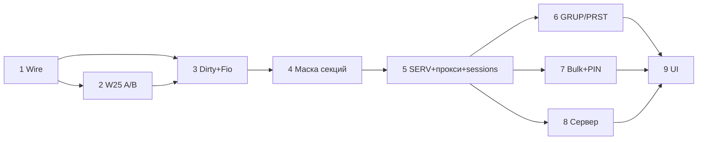

# План реализации консоль ↔ сервер (финальный)

Единственный список TODO. Справочники: `[SYSTEM.md](SYSTEM.md)` (решения A–H, отношения консоль ↔ сервер), `[PROTOCOL.md](PROTOCOL.md)` (транспорт). Нерешённое — раздел «Открытые вопросы» в конце.

**Файл плана:** `PUMS/Console/src/smcp/IMPLEMENTATION.md`

Принцип: от простого к сложному; одна фаза → собирается → можно PR.  
Цель кода: универсальный multi-seg движок пульта (группы + пресеты); продукт (PUMS UI) и будущий слой **cue** — снаружи.

---

## Модель (не ломаем)

```text
Show (ATYP / APCH / GRUP / PRST / SETT)
show::AxisPool: TypeBank + PatchBank → прокси (show::Patch* + ShowType* + live + Profile cache); POD в show/show_axis.hpp
Group / Preset = SectionPool, wire-слоты
MConsole = composition root (банки, Fio, сессии, хуки)
UI = жесты / paint / uiMessages (без пользовательских строк в модели)
Cue = позже, над PRST
```

Фасад «все жесты на MConsole» **не делаем**. Примитивы на прокси оси / Group / Preset; PUMS UI сам собирает toggle.

---


## Фаза 0 — дизайн (готово)

- [x] Решения A–H, storage-split, multi-byte, PIN, Absolute/Relative, ShowBlob B  
- [x] `SYSTEM.md`, `PROTOCOL.md`

---


## Фаза 1 — wire / типы (готово)


| #   | Задача                                                                                                     |
| --- | ---------------------------------------------------------------------------------------------------------- |
| 1.1 | [x] `MotionTarget`: signed, единицы kind, **Absolute | Relative**; убрать `_mm` из имён                    |
| 1.2 | [x] `ResetFault` `0x22` + pack/unpack + stub TX/RX                                                         |
| 1.3 | [x] `Get`/`Set`/`DataService`/`Data` (`0x31–0x34`, `kInlineMax`) + `set`/`get`/`onRxComplete` |
| 1.4 | [x] Каталог MsgId (`SYSTEM.md` §5)                                                                         |


---


## Фаза 2 — W25 A/B (готово)


| #   | Задача                                                               |
| --- | -------------------------------------------------------------------- |
| 2.1 | [x] `W25qShowFile`: 2 сектора, seq+magic/CRC, ping-pong              |
| 2.2 | [x] Снаружи тот же `IFile` (Fio не знает A/B)                        |
| 2.3 | [x] Обрыв на inactive: CRC/seq не проходят → остаётся прежний active |


---


## Фаза 3 — dirty + политика Fio/носители (готово)


| #   | Задача                                                             |
| --- | ------------------------------------------------------------------ |
| 3.1 | [x] Dirty на секцию/пул; `*` = `IShow::isEdited()` (any)           |
| 3.2 | [x] bak = W25; bad SD → auto bak; LKG на `begin`; статус `BakOnly` |
| 3.3 | [x] Нет SD → `saveShow()` только bak → `BakOnly`                   |
| 3.4 | [x] После SD-save → `syncBak()` → `Ok`                             |


---


## Фаза 4 — маска секций Fio (готово)


| #   | Задача                                                                                                                                              |
| --- | --------------------------------------------------------------------------------------------------------------------------------------------------- |
| 4.1 | [x] Частичный open по маске FourCC (`TagMask` / `Tags<N>`; не merge — остальные секции очищаются, без имени); save только полный; UI чекбоксы — 9.1 |
| 4.2 | [x] Required без маски (`MissingRequired`); SERV `required` — с секцией в 5.2                                                                       |
| 4.3 | [x] `Overflow` + `allowTruncate`; без тихого truncate; bak не на Overflow; UI MsgBox — 9.2                                                          |
| 4.4 | → перенесено в 6.1a (нужны SERV и `(seg, Selection)`)                                                                                               |
| —   | [x] `SectionDesc.crc32` (v0x0117); пул = CRC каждой секции                                                                                          |


---


## Фаза 5 — оси шоуфайла, слоты, сессии


| #   | Задача                                                                                                                                                                                                                                                                                                                                                                                                                                             |
| --- | -------------------------------------------------------------------------------------------------------------------------------------------------------------------------------------------------------------------------------------------------------------------------------------------------------------------------------------------------------------------------------------------------------------------------------------------------- |
| 5.1 | ✅ `axis::Profile` + `Route` + `IAxis` (с id); `show::ShowType` / `show::Patch` в `smcp/show/show_axis.hpp`                                                                                                                                                                                                                                                                                                                                         |
| 5.2 | ✅ `show::AxisPool` = TypeBank (ATYP) + PatchBank (APCH), `required`; `typeOf` / `isUsedType`; в `Show` (`kVersion` 0x0118); бюджет W25. SegHdr/SERV не в шоу — inventory с сервера (7.x)                                                                                                                                                                                                                                                           |
| 5.3 | Прокси оси на APCH (B1) вместо банков: `show.patch.patch[i]` + `typeOf` + live; Telemetry / Select / UI — через прокси. Убрать `storage(server_id)` на консоли. Live — массив параллельно APCH (вне шоуфайла); кэш `Profile` по `Route` из сессии                                                                                                                                                                                                  |
| 5.4 | Gaps axis_id; маска `Selection` 32 бит vs inventory 24 (биты 24…31 → `MechNotFound`): резать по `mechCapacity()` или поднять inventory до 32                                                                                                                                                                                                                                                                                                       |
| 5.5 | `MaxSessions ≥ MaxSeg` (сейчас `GroupConsole<24>` с 1 слотом; расширить `SessionBank` в `MConsole`); `start` на каждый server_id                                                                                                                                                                                                                                                                                                                   |
| 5.6 | console_id из NVM до `CanLink` / `begin` (сейчас `CanLink(board.can, 1u)` + `begin(kConsoleIdMin)` в `Console/main.cpp` и `main_test.cpp`); смена id / после IdConflict → `begin(id)` + `start(server)`. Хранение — 5.9                                                                                                                                                                                                                            |
| 5.7 | Потолки `{tag, max_count}` секций — таблица в прошивке (A3 / H1)                                                                                                                                                                                                                                                                                                                                                                                   |
| 5.8 | Live Show (и staging Show под MERGE) — в CCM 64K (`.ccmram`, сейчас пустая), освобождает основную RAM. Ограничения: нет DMA (SD / SPI сейчас polling — при включении DMA прямые чтения в Show запрещены, заметка у объявления); стартап секцию не копирует и не обнуляет → `NOLOAD` + ctor задаёт все поля; `memstat` CCM не считает; static_assert на суммарный размер ≤ 64K                                                                      |
| 5.9 | Настройки пульта на W25 (E2): карта W25 константами в одном месте (шоу A/B + настройки, static_assert на непересечение); 2 сектора по 4K сразу перед регионом шоу; журнал записей фиксированного размера (~32 B: magic, seq, `console_id`, яркость, флаги, CRC16) — при старте последняя валидная, сектор полон → пишем во второй, первый стираем; нет валидной — id по умолчанию + подсказка в UI. Яркость писать при выходе со страницы настроек |


---


## Фаза 6 — группы и пресеты


| #    | Задача                                                                                     |
| ---- | ------------------------------------------------------------------------------------------ |
| 6.1  | GRUP: `(seg_id, Selection)`; local-test `group_pool` не в leaf                             |
| 6.1a | (бывш. 4.4) A2: `seg_id` ∉ SERV → warning + disarm API слотов; revalidate после save патча |
| 6.2  | SETT: номер группы «текущего шоу» + API фильтра клеток                                     |
| 6.3  | PRST: `{ seg_id, Selection, MotionTarget }` + overlap на record/load                       |
| 6.4  | Recall: все Select→Ack → SetTarget; Atomic → rollback                                      |
| 6.5  | Спектакль: запрет Select в recall / trySelect — после решения Q1                           |


---


## Фаза 7 — multi-byte config + PIN


| #   | Задача                                                        |
| --- | ------------------------------------------------------------- |
| 7.1 | Теги объектов + Get/Notify(hash) + broadcast                  |
| 7.2 | Get/Set(blob) → multi-byte Node + CRC; abort по HbLost / Nack |
| 7.3 | ServiceUnlock + Set(blob); PIN hash на сервере                |
| 7.4 | Apply SERV: смена kind → warn/disarm                          |
| 7.5 | Тег ShowBlob (UI sync — later)                                |


---


## Фаза 8 — сервер (CanDemux + привод)


| #   | Задача                                                                                                                        |
| --- | ----------------------------------------------------------------------------------------------------------------------------- |
| 8.1 | CanDemux: 1 ICAN → 2 Node                                                                                                     |
| 8.2 | Два logical server_id/seg; jack→seg                                                                                           |
| 8.3 | Паспорта + hash на сервере                                                                                                    |
| 8.4 | `DriveMech::setTarget` (сейчас пустой: Ack + Telemetry, ось стоит): Moving + позиция, либо отказ до Ack                       |
| 8.5 | `acceptSetTarget`: концевики и ход → `Limits` (сейчас Ok всем)                                                                |
| 8.6 | `resetFault()` / `resetGlobalFault` leaf: GPIO + снятие бита Fault (сейчас пусто; кнопку сброса в UI не включать раньше)      |
| 8.7 | Telemetry хода: Δposition / rate-limit в тике привода, `pushTelemetry`                                                        |
| 8.8 | Линк к платам (CAN2 / UART): свой PDU привода, второй ILink не через тот же Node. CAN2 на F407 закрыт — в `board` только CAN1 |


---


## Фаза 9 — UI продукта (PUMS)

Nextion `NX1060P101`, 600×1024, проект `src/PUMS 2.5.HMI`. Правки HMI: Editor → Compile → `.tft`, CLI нет.

**Не трогать:**

- Геометрию и нумерацию клеток на `work` (раскладка = лебёдки в зале, дыра `b24` — пустое место сцены).
- Затемнитель `t0` на `mFile` / `mGroup`. StatusBar — оверлей поверх HMI.
- Клетки McUI-оверлеем поверх кнопок (`bco` / `txt` делают `ref` и затирают canvas).
- baud 250000, CAN 1 Мбит, `DriveMech::kMaxSelected`.
- Поездку в высоту на экране — пока не готов 8.4.
- Rope / Chain и `cfgpio` в HMI — пока нет инвентаря и назначения ног (8.2).


| #    | Задача                                                                                                                                                                                                                                                                                                                                                                                                                                               |
| ---- | ---------------------------------------------------------------------------------------------------------------------------------------------------------------------------------------------------------------------------------------------------------------------------------------------------------------------------------------------------------------------------------------------------------------------------------------------------- |
| 9.1  | Чекбоксы секций только у open (save только полный)                                                                                                                                                                                                                                                                                                                                                                                                   |
| 9.2  | MsgBox: overflow YesNo (Yes → повтор `openShow(name, tags, true)`; сейчас в `BrowserPage::commitOpen` только OK-сообщение), config mismatch; при `BakOnly` и появлении SD — предложить save на карту; без SD — только «Сохранить» + пометка «только W25Q»                                                                                                                                                                                            |
| 9.3  | Фильтр «только группа шоу»                                                                                                                                                                                                                                                                                                                                                                                                                           |
| 9.4  | Контекст/страницы seg                                                                                                                                                                                                                                                                                                                                                                                                                                |
| 9.5  | E-Stop release → ResetFault                                                                                                                                                                                                                                                                                                                                                                                                                          |
| 9.6  | Контраст и заглушки HMI (см. ниже)                                                                                                                                                                                                                                                                                                                                                                                                                   |
| 9.7  | Страница настроек: яркость `dim=` (сейчас 100 в `Program.s`), номер пульта (5.6), свитч isolate (9.12); в reserved шоуфайла не класть яркость и id                                                                                                                                                                                                                                                                                                   |
| 9.8  | Клетка: статусы, высота, жесты (см. ниже)                                                                                                                                                                                                                                                                                                                                                                                                            |
| 9.9  | StatusBar: связь (`ServerSession::isOpen`), конфликт id, режим Work / Блок / Спектакль; память — только debug или длинный тап                                                                                                                                                                                                                                                                                                                        |
| 9.10 | Настройки (яркость, часы) из Спектакля; guard страниц: `onLoad` смотрит mode (HMI page по UART сейчас открывает файл / RTC в обход `assignOk()`)                                                                                                                                                                                                                                                                                                     |
| 9.11 | Block на клетке vs группе: развести подписи и жест (клетка — сегментный `Block` всем пультам, группа — флаг GRUP); не вторым цветом той же кнопки                                                                                                                                                                                                                                                                                                    |
| 9.12 | Isolate — частный режим этой консоли (после всей модели). Сейчас: `isolateGroup` в SETT + `markEdited()` (`*`), глушит только Press клетки; `CGroup::recall` / `CGMech::trySelect` его не смотрят → recall группы выделяет изолированные оси. Решить: привычка оператора (вынести из SETT в настройки пульта 5.9, без `*`) или свойство постановки (SETT без `*`, если больше ничего не менялось); фильтр маски на стороне PUMS UI, не в модели SMCP |


**9.6 Контраст и заглушки.** Кнопки `#292829` тонут в фоне `#101410`; Disabled = цвет страницы; в HMI зашиты «Натан Мудрый», «01 -», «1»…«24».

- Поднять `bco` обычной кнопки (ориентир `#3A3A3A` в RGB565).
- Клеткам и строкам групп — `isbr=1`, как у Файл / Блок / Спектакль.
- Disabled: отдельный mute-fill и приглушённый текст.
- Blocked: янтарная обводка, заливку `#521418` оставить. Янтарь `#FFA500` (selected / спектакль) не менять.
- Пустые `txt` у файлов, групп, заголовков браузера. Стартовые цвета = Disabled.
- Разделители даты на `settings` (`t8` / `t9`) — точки, не двоеточия.
- Цвета синхронно в `appColors.hpp`, `buttons.hpp` и `.HMI`.

**9.8 Клетка.** `refreshCell` рисует Blocked / Isolated / Ready / Selected+Ready; нажатие не знает Fault, чужой holder и «кадр не ушёл».

- Кнопка `b0`…`b23`: тач, цвет статуса, номер (font1). Рядом `Text` (font2, `sta=3`, `tsw=0`, id после кнопки): высота цифрами. Не `xstr` поверх кнопки, не Progress Bar, не `WinchButton::setPrefix`.
- Цвета Busy / Moving / Fault / Limit — расширение `StateColors`, не новые виджеты.
- Чужой holder: не слать Select, MsgBox «занято пультом N».
- Fault: не выделять, MsgBox; кнопка сброса — после 8.6.
- Moving: клетка остаётся выделенной, цвет не как Select; Deselect не блокировать, пока нет Stop.
- Limit: нажатие не запрещать, достаточно цвета.
- Нет связи / телеметрии: высота «—», клетка не Active (F2).
- Высота с порогом (Δ или ≤10 Гц на клетку) — иначе 24 оси забьют UART 250000.
- Nack уже открывает MsgBox (`showSmcpNack`, в т.ч. SelectLimit) — второй разбор кода не добавлять.
- MsgBox / синхронизацию клетки не открывать синхронно из `Node::update`.

---


## Зависимости




**Сейчас:** фаза 5.

---


## Вне плана


| Что                                                                                                                                                                                                                                                                                                                                             | Когда               |
| ----------------------------------------------------------------------------------------------------------------------------------------------------------------------------------------------------------------------------------------------------------------------------------------------------------------------------------------------- | ------------------- |
| Cue поверх PRST                                                                                                                                                                                                                                                                                                                                 | большие консоли     |
| Юзеры пульта (Operator/Editor/Admin)                                                                                                                                                                                                                                                                                                            | после прода         |
| Live collaborative sync шоу                                                                                                                                                                                                                                                                                                                     | над ShowBlob        |
| UI «отправить/принять шоу»                                                                                                                                                                                                                                                                                                                      | со вторым пультом   |
| FlightObject, шифрование CAN, Block multi-console policy (E1)                                                                                                                                                                                                                                                                                   | позже               |
| Миграция старых SMCP (A5)                                                                                                                                                                                                                                                                                                                       | не делаем           |
| MERGE двух шоу / скрещивание SERV (в т.ч. догрузка GRUP/PRST/SETT к живому SERV): временный staging Show только на время merge (место — CCM рядом с live, 5.8; запасной вариант — стек с проверкой запаса `memstat` → `NoMemory`), `checkMerge`/`mergeFrom` на секцию, база `copyFrom`/`checkLayout`; fingerprint пула (CRC секций / wire hash) | после SERV (5.x)    |
| Чтение шоу с W25Q стримом секций; МК F767/H7 (H1)                                                                                                                                                                                                                                                                                               | когда упрёмся в RAM |


---


## Сейчас в коде → станет


| Сейчас                           | После плана                         |
| -------------------------------- | ----------------------------------- |
| GRUP одна Selection              | `(seg, Selection)`                  |
| `storage(server_id)` / CMechBank | прокси на APCH + live (5.3)         |
| MaxSessions = 1                  | ≥ MaxSeg                            |
| console_id = 1 константой        | настройки пульта на W25 (5.9)       |
| `DriveMech` пустой               | 8.4–8.7                             |
| ATYP/APCH в Show ✅               | bulk Profile / PIN / CanDemux — 7–8 |


---


## Открытые вопросы


### Q1. Спектакль: что запрещает и где guard (→ 6.5, 9.10)

- **Было (C5):** только UI — в этом режиме Select не вызывается; guard в `trySelect` / `recall` / `IConsole::select` не обязателен.
- **Было (старый TODO):** запрет Select в `trySelect` / `recall` / `IConsole::select`, в модели.
- **Факт в коде:** `MConsole::Mode` — только хранение (`mode()` / `setMode()`, сброс в Work на `onFioEvent` Loaded/New). Запреты — в `WorkPage`: `assignOk()` == false → нет «Файл», Block, записи групп. Select клеток и recall групп **не** запрещены. HMI `page` по UART открывает файл / RTC в обход `assignOk()`.
- **Вопрос 1:** Спектакль — блокировка редактирования (Select и recall разрешены, как сейчас) или запрет движения тоже?
- **Вопрос 2:** где guard?
- **Предложение:** режим UI; флаг остаётся в `MConsole`, проверки — в UI (единый предикат + `onLoad` страниц, 9.10); в модель SMCP (`trySelect` / `recall` / `IConsole::select`) не тащить. Guard в `MConsole` — только когда появятся не-UI источники действий (приём ShowBlob, cue), и на входе именно этих операций. Если Select разрешён — 6.5 удалить.

