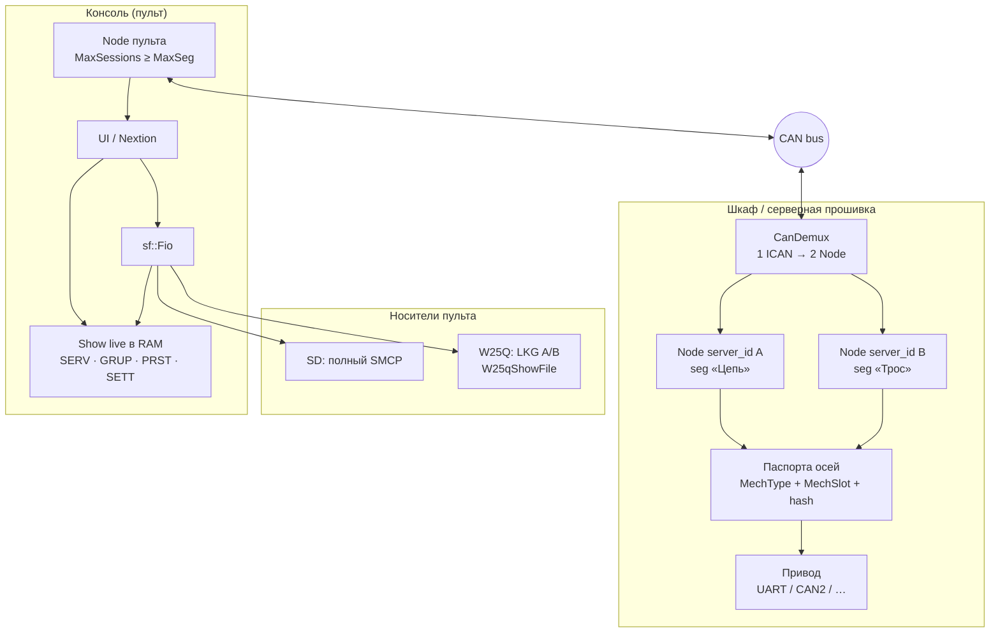
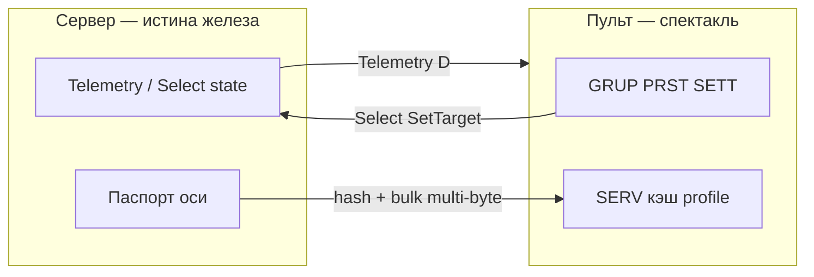
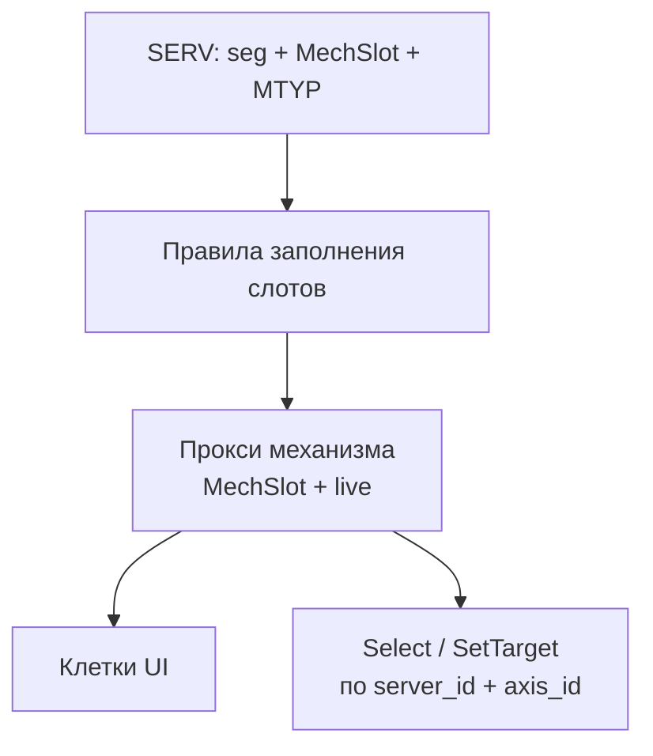
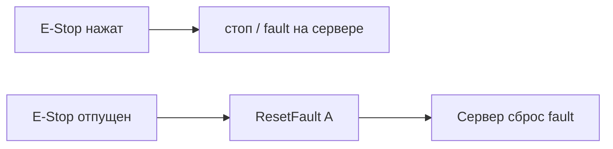
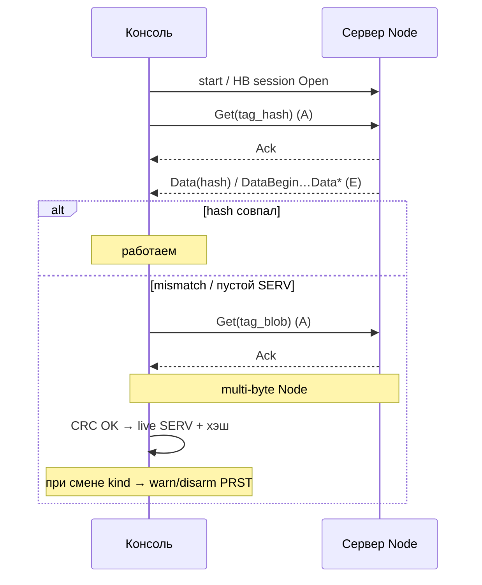
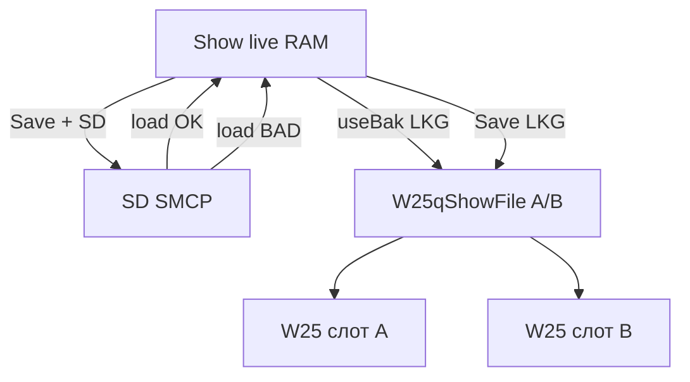
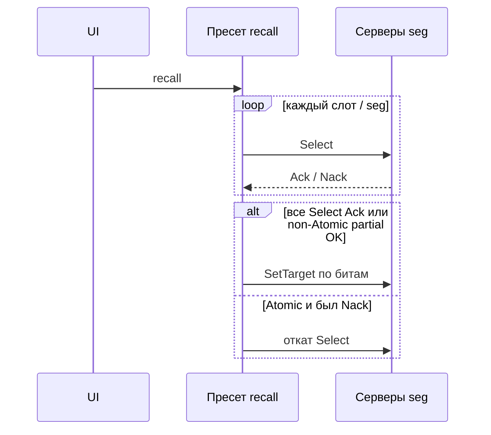

# Консоль ↔ Сервер — логика системы

Справочник принятых решений и всех отношений консоль ↔ сервер (над Node / Session).  
Транспорт (кадр, Heartbeat, очереди, классы A–E) — [`PROTOCOL.md`](PROTOCOL.md).  
План кода (фазы, все TODO) — [`IMPLEMENTATION.md`](IMPLEMENTATION.md).  
Открытые вопросы — в конце [`IMPLEMENTATION.md`](IMPLEMENTATION.md).

Id решений (**A1…H2**) — стабильные, на них ссылается план.

---

## 1. Общая картина

Одна **консоль** (пульт) на CAN. На стороне **шкафа** — один физический CAN, в прошивке сервера до **двух logical Node** (например цепь / трос) через **CanDemux**. Привод лебёдок — **внутри сервера** (UART/CAN2/…); пульт этого не видит.



- **B3.** Цепь/трос: **одна консоль**; в прошивке **сервера** — два `Node` на один CAN (два logical `server_id` / seg). Пульт видит две peer-сессии. Jack→seg — на сервере при сборке inventory.
- **B4.** **CanDemux** — спец-драйвер: один `ICAN` → два `Node`; RX demux по `dst`; TX в общий CAN. Не один Node на два ILink.
- **E3.** Drive / motion — **внутри сервера**. Пульт шлёт SetTarget; как сервер двигает ось — его дело.
- **E5.** Линк к платам/приводу (CAN2 / UART / …) — **только сервер**. Свой PDU привода, не расширение транспортного `message.hpp`; Select / Block / holder на CAN2 не тащить. `DriveMech` мапит плату на `IAxis`. Пульт видит «ось N на `server_id`».

---

## 2. Кто чем владеет

Несколько пультов должны видеть **один** механизм; декодер/ноль — не локальная правда каждого SD.

| Данные | Владелец | Где у пульта |
|--------|----------|--------------|
| scale, home/zero, `kind`, hard limits | **сервер** (паспорт оси / commissioning) | кэш в SERV после bulk; пульт не «держит ноль» |
| live: position, holder, block, fault | **сервер → Telemetry** | live прокси механизма (не в шоуфайле); все пульты видят одно |
| GRUP / PRST / SETT | **шоуфайл / live Show** | RAM + SD/W25; обмен между пультами = файл / ShowBlob |
| MotionTarget в пресете | пульт хранит числа, сервер исполняет | PRST; единицы = те, что объявил сервер |
| MechType / MechSlot в SERV на SD | кэш для UI / offline | не источник истины online |
| console_id | NVM пульта (**E2**) | не в шоу |
| service PIN | **сервер** NVM | UI только вводит |



**Чего не делать:** копировать паспорт оси в каждый слот пресета; слать по CAN «поправь свои пресеты» на другие пульты; пресеты/группы по шине не авто-править.

---

## 3. Узлы: IConsole / IServer

`IConsole` / `IServer` наследуют **Node** (`PROTOCOL.md`), держат registry `Session*`; объекты сессий — у leaf:
`MConsole` — `SessionBank<ServerSession>`, `MServer` — `SessionBank<SessionConsole>`.

- **Консоль** — master HB: `start(server_id)` после `Node::Ready`. API: `begin(console_id)` / `end` / `start(server)` → `ServerSession*` / `server(peer)` / `update` / `onStatus` / `onLink`. Close — `Session::close`. Линк — `ServerSession::isOpen()`. Select/Block/SetTarget/GetTelemetry/ResetFault — фасады `ServerSession` над `Session::send`.
- **Сервер** — slave: `begin(server_id)` / `sessionByPeer` / `SessionBank<SessionConsole>`, слоты без `start`. RX класса A — `SessionConsole::onPacket` → `SMCP_IF_MSG(Select/…)` + Ack/Nack; снимок — Telemetry (D) через `Node::send(…, kBroadcastId)`.
- Telemetry (D) разбирает наследник Node (`IConsole::onPacket`), не Session.
- HB lost на консоли: Status Ready, `close(HbLost)` → `onFault`; снова `start()` — решение `MConsole`.
- IdConflict своего id: сервер в `onFault(nullptr)` снимает хвосты Select.
- Политика отказа Select (`acceptSelect`) / Block (`acceptBlock`) / SetTarget (Limits) — в leaf сервера.
- **E1.** `acceptSelect` / SelectLimit — **оставить**. Политика Block при >1 пульта — позже.
- **E2.** `console_id` — **сохранять** в регионе «настройки пульта» на W25 (не шоуфайл, не backup RTC: не должен пропадать с батарейкой VBAT), читать до `begin`; смена → `begin` + `start`. Там же яркость (и isolate, если он операторский — 9.12).
- **H2.** `MaxSessions ≥ MaxSeg`; `start` на каждый `server_id` из патча.

Отладка на одном MCU: консоль и сервер — два `MockCan` + `connect()` (`main_test.cpp`).

---

## 4. Адресация осей на пульте

- **B1.** На пульте **нет** банков механизмов (`storage(server_id)` / ObjRegistry / `CMechBank`). Доступ к механизму — через **прокси на SERV**: `ServPool::segment(server_id)` / `mech(server_id, axis_id)` → прокси = `MechSlot` (+ `MechType` из MTYP) + live-состояние. Второй сегмент = ещё один `SegHdr` в SERV, отдельного банка нет. (На сервере свой `storage()` для приводов — отдельно.)
- **B2.** Gaps `axis_id` **разрешены**, id не уплотняем. Нет в SERV → пустая клетка; бит на отсутствующий id → MechNotFound / вырезать при record.
- **H2** — см. §3.



Telemetry принимается, только если сессия с этим peer Open и `(src, axis_id)` есть в SERV; иначе отбросить. Сейчас в коде (до 5.3) — через `storage(src)`.

---

## 5. Каталог northbound сообщений

PDU — `smcp/mech/message.hpp`; коды Nack — `ErrorCode` там же; Nack `detail` = `Selection.raw()`.

| Id | Msg | Класс | Кто → кому | Смысл |
|----|-----|-------|------------|--------|
| | **Select** | A | Console → Server | Выделение осей (Action Add / Remove / Set) |
| | **Block** | A | Console → Server | Сегментный Blocked (Action Add / Remove / Set) |
| | **GetTelemetry** | A | Console → Server | Снимки осей по маске (без смены состояния) |
| | **SetTarget** | A | Console → Server | Цель движения: единицы kind + Absolute \| Relative |
| 0x22 | **ResetFault** | A | Console → Server | Пустая маска — globalFault (GPIO). Биты — Fault осей |
| 0x23 | **ServiceUnlock** | A | Console → Server | `pin_hash:u32` LE на сессию: совпал → Ack, нет → Nack |
| 0x31 | **Get** | A | *(транспорт Node)* | `tag:u8`. Ответ: Data ≤7 или DataBegin→Data*; клиент Ack/Nack |
| 0x32 | **Set** | A | *(транспорт Node)* | `tag:u8` + ≤7 B inline; длиннее → DataBegin→Data*; server Ack/Nack |
| 0x33 | **DataBegin** | E | *(транспорт Node)* | `tag\|size\|crc32` (DLC=7); конец по size |
| 0x34 | **Data** | E | *(транспорт Node)* | кусок / короткий ответ Get: seq\|data≤7 |
| | **Telemetry** | D | Server → broadcast | Снимок оси после **изменения** состояния / движения / GetTelemetry |

`tag` — opaque `uint8_t`; значения — вместе с объектами. Select/Block/SetTarget/Telemetry/HB — без multi-byte. Dual-axis Telemetry — **не** в MVP.

### Select → Ack + Telemetry

```text
Console:  Select(mask, action, txn_id=N)
Server:   1) Проверка (без изменений): маска валидна / свободна или наша /
             Ready / не Blocked / `acceptSelect` — иначе Nack
             (Busy / Safety / NotReady / SelectLimit / MechNotFound)
          2) Commit: take и drop в одном проходе, затем Ack + Telemetry по сменившимся
             (бит ≥ `mechCapacity()` / нет оси → Nack MechNotFound)
```

- Лимит Select на сегменте — leaf в `acceptSelect`: слияние (чужие Selected ∪ маска консоли) → **SelectLimit**.
- Deselect снимает **только своё**; бит чужого holder → Nack Busy. Set с bit=0 чужого не трогает.
- Потеря HB на сервере (`Session::onFault(HbLost)`): снять Select этого peer + Telemetry по сменившимся (как Deselect всех своих). Block не трогаем.
- В Telemetry есть **`holder_id`** (кто держит Select). Смена `0 ↔ console` = изменение → Telemetry обязателен.
- Повторный Select без изменений → **Ack**, Telemetry можно не слать.
- Массовый Set на 32 оси с 32 изменениями → 1 Ack + 32 Telemetry (редко; ок для CAN).
- Консоль по Nack с ненулевым `detail` (маска осей) запрашивает **GetTelemetry** по этим осям, кроме `MechNotFound` (осей нет).

Telemetry при **движении** — отдельно: по Δposition / rate-limit на стороне сервера (приводной слой). Базовый `IServer` шлёт снимок при смене select / block / SetTarget / GetTelemetry / HbLost, не при движении.

**Не** трактовать Telemetry как RPC-ответ на Select: ответ на Select — Ack/Nack.

### GetTelemetry → Ack + Telemetry

```text
Console:  GetTelemetry(mask, txn_id=N)
Server:   1) Оси из mask существуют (иначе Nack MechNotFound)
             Пустая mask = все оси inventory сегмента (`mechCapacity()`)
             Бит ≥ capacity / нет оси → Nack MechNotFound
          2) Ack + Telemetry (D) по каждой запрошенной оси — снимок без commit
```

После `onLink(server, true)` консоль обычно запрашивает маску своих слотов (зеркало Ready/holder до первого Select).

### Block → Ack + Telemetry

```text
Console:  Block(mask, action, txn_id=N)
Server:   1) MechNotFound / `acceptBlock` — иначе Nack
          2) Commit: Status::Blocked take/drop, снятие Select при block (IAxis::block)
             → Ack + Telemetry по сменившимся
```

- **Add / Remove** — дельта по маске; **Set** — абсолютная маска blocked сегмента (Set с пустой маской снимает Block со всего сегмента).
- Кто имеет право слать Block — leaf `acceptBlock` (пока Ok любой консоли `0x01…0x0F`; политика multi-console — **E1**).
- **C3.** Blocked GRUP ≠ сегментный Block: recall/trySelect смотрят оба; клетка → PDU `Block` (все пульты, снятие Select); группа → только флаг GRUP в шоуфайле.

### SetTarget → Ack + Telemetry

```text
Console:  SetTarget(target [, axis_id], txn_id=N)
Server:   1) Одна ось или все с Select этой консоли
             MechNotFound / не наш Select → Busy / Blocked → Safety /
             не Ready → NotReady / `acceptSetTarget` (Limits) — иначе Nack
             (сначала проверка всех, потом commit)
          2) IAxis::setTarget → Ack + Telemetry по затронутым
```

Контракт: сначала `Select`, потом `SetTarget`.  
DLC=7 (`all_selected`): уставка на всё текущее Select консоли; пустой Select → Ack без дела.  
DLC=8: одна ось, `axis_id` в конце.  
Префикс: `mode | target i32 LE | speed u16 LE`. `mode`: `0` Absolute, `1` Relative. Иное → кадр не unpack.  
Единицы — `kind` оси. Ускорения в цели нет.

- **G1.** MotionTarget — **условные единицы** `kind` (signed int, без `_mm`) + **Absolute | Relative** для всех осей.
- Continuous: паспорт оси с **min/max на краях диапазона** (полные пределы int / «нет упора») ⇒ сервер трактует как continuous (`axis::Flag::Continuous`; Rotary — оборот, Linear — кольцевая дорога и т.п.). Пресет хранит те же числа + тип хода; «delta-only пресета» нет.

### ResetFault → Ack

```text
Console:  ResetFault(mask, txn_id=N)
Server:   mask пустая → resetGlobalFault (GPIO сегмента) → Ack
          биты        → нет оси → Nack MechNotFound
                       иначе IAxis::resetFault → Ack + Telemetry этих осей
```

- **E4.** Отдельный MsgId. Пульт шлёт после **снятия** E-Stop (release), не в момент нажатия; пустая маска = globalFault в сессию сегмента.
- Пустая маска — не «все оси». Ненулевая — локальный Fault указанных механизмов.
- Select / Ready / Block не требуются. Пин GPIO и снятие бита Fault — leaf; база Ack шлёт, линию и бит не трогает.



### Get / Set + ServiceUnlock

Get/Set/DataBegin/Data — `libs/smcp` (`msg::Id` 0x31…0x34): `set(tag,IBuf)`/`get(tag,IBuf)` + `onSetBuffer`/`onSet`/`onReply` (tag отдельно от `IBuf`).  
Default Get/Set → Nack `msg::Nack::Error::NotSupported`. Теги / PIN — фаза 7.  
Порог inline = `kInlineMax` (7); blob/`DataBegin` size≥1. `ServiceUnlock` — northbound `smcp/mech/message.hpp`.  
Nack: транспорт ≤`Max=0x0F`; прикладной `ErrorCode` с `0x10…`.

```text
Get(tag) → Nack | Data(seq=0, ≤7) | DataBegin…Data*   ; без Ack клиента
Set(tag, ≤7) inline | Set + DataBegin…Data*           ; итог — Ack/Nack приёмника
ServiceUnlock → Set(tag, …) → multi → Data(hash) broadcast
```

---

## 6. Подключение и синхронизация паспортов

**F3b.** Без VID/UID: сверка по **хэшу** настроек сервера; выгрузка — **multi-byte pull** (куски ≤6 B data). `server_id` — только адрес сессии. **B6** (basic-шаблон серверов) снят: патч приходит с сервера.



- Обрыв HbLost / Nack во время pull → abort, буфер отбросить.
- **Fio** в multi-byte не участвует: blob → RAM SERV, потом обычный Save.
- **Смена на сервере online:** broadcast hash (Data / multi) → пульты как при mismatch (предложить / забрать bulk → обновить profile / UI).
- **Commissioning (вариант C):** обычный режим только читает; `Set` длинного blob — сервис.
- **WriteConfig (сервис):** PIN → `ServiceUnlock` → `Set(tag_blob)` → multi-byte Node → hash broadcast.

**Совместимость пресетов после смены паспорта:**
- home/scale — только сервис; штатному пульту всё равно (числа PRST = signed int от нуля).
- limits / нет оси → runtime **Nack** с сервера; нет seg → ошибка консоли (**A2**). PRST заранее не инвалидировать.
- Invert — дело сервера (в profile может быть для UI).
- **`kind` / `unit_exp`** — единственное критичное: при смене profile найти axis_id со сменившимся kind или unit_exp → warn + disarm затронутых PRST/GRUP слотов; файл не чистить.
- Fingerprint в каждом слоте PRST — не нужен.

**Сервис / PIN + юзеры пульта:**

| | До прода (MVP) | После прода |
|--|----------------|-------------|
| Set(blob-тег) | **PIN на сервере** (хэш в NVM) + `ServiceUnlock` на сессию | то же |
| Юзеры спектакля на пульте | **нет** — один оператор | уровни Operator/Editor/Admin + опц. PIN в NVM/SETT пульта |
| Шифрование CAN | нет | если понадобится — отдельно |

PIN сервера ≠ юзеры пульта. Юзеров на сервер привода не класть.

**Синхрон шоуфайла между пультами:** тег `ShowBlob` в тех же multi-byte MsgId; сервер ни при чём; сессия пульт↔пульт. Live collaborative — надстройка позже.

---

## 7. Шоуфайл, FIO, W25

Один тип файла SMCP = набор секций (SERV / GRUP / PRST / SETT …). «Чистый патч» / «чистое шоу» — какие секции есть, не два класса Show.

- **A1 / A4.** Рабочая копия **одна в RAM** (`Show` live); второй (staging) Show допускается только временно, на время MERGE. С W25/SD in-place не редактируем; flash/SD — сериализованный снимок, указатели на W25 не натягиваем (SPI NOR).
- **Open** — частичный по маске `TagMask` / `Tags<N>` (как в Eos): выбранные секции из файла, **остальные очищаются**, не merge; при частичном open имя не берём, Show помечается edited. **Save** — только полный (частичного save / export нет).
- Проверки до изменения live: header CRC16, body CRC32 (по записанному/прочитанному файлу), каталог, `SectionDesc.crc32`; required-секции (`MissingRequired`); `Overflow` без `allowTruncate`. `Overflow` / `MissingRequired` — без bak-fallback.
- **A3.** Overflow ёмкости: open без `allowTruncate` → `Overflow`, live не тронут → UI MsgBox «Загрузить частично?» (секция, headers/slots found vs max); Yes = повтор того же open с `allowTruncate = true` (как `confirmed` у save); No = ничего не меняется, bak не подставляем. Потолки `{tag, max_count}` — таблица в прошивке (числа позже).
- **A2.** GRUP/PRST `seg_id` ∉ SERV → **предупреждение**, файл принимаем; слоты на отсутствующий seg — тот же UI, recall/record **disarm** до правки патча + save. Данные из файла не чистить.
- **A6.** Dirty — флаг на `ISection` / пул; UI `*` = any (`IShow::isEdited()`). Load снимает dirty.
- **A5.** Миграции старого формата нет, пока нет прода; `Header.version` не разветвляем.
- **W25 A/B** (2 сектора, ping-pong, `LKGS` + seq + CRC16) — внутри `W25qShowFile`; для Fio обычный `IFile` bak. Защищает только от обрыва питания при Save на W25.
- Старт пульта: LKG с bak → `BakOnly`. `openShow` — SD; при сбое/битом → bak → `BakOnly`.
- Нет SD → `saveShow()` только bak → `BakOnly`; UI: только «Сохранить» (не «как…»), пометка «только W25Q». Появилась SD → предложить сохранить на карту. Есть SD: Save → SD + `syncBak()` → `Ok`.
- **H1.** RAM: сначала потолки `{tag, max}` (A3); live и staging Show — кандидаты в CCM 64K (только CPU, без DMA; план 5.8); МК F427→F767→H7 — когда упрёмся. Возможно чтение шоу с W25Q стримом секций.
- SERV обязателен в любом open (required, с 5.2): без SERV шоу-секции не грузятся. Догрузка секций к уже живому SERV (оставить live SERV, из файла взять GRUP/PRST) — это MERGE, не open.



---

## 8. Группы и пресеты

- **C1.** `smcp::test` / local selection (`group_pool.hpp`) — старый код, не база leaf. Цель: wire-слоты `(seg_id, Selection)` в пуле.
- **C2 / C4 / D4.** Partial multi-seg: **best-effort** (частичный Select и частичная уставка) + отчёт Nack. **Atomic** → откат успешного Select при любом Nack.
- **B5.** «Текущее шоу» — **обычная** группа, её номер в SETT; record в неё как в любую; UI-фильтр «только используемое» смотрит её. Не отдельный тип GRUP (бывш. Mute).
- **C5.** Спектакль — открытый вопрос Q1 в [`IMPLEMENTATION.md`](IMPLEMENTATION.md). Isolate — частный режим этой консоли (PUMS UI), не модель SMCP; план — 9.12.
- **D1.** Слот пресета: `{ seg_id, Selection, MotionTarget }`. Несколько seg → несколько слотов на один header.
- **D2.** Recall: сначала **все Select**, дождаться **Ack по всем**; потом **SetTarget**. Без Select / Nack на Select → Target не слать.
- **D3.** Overlap оси в слотах одного пресета — reject при record и load (isValid false). Отдельной «починки» нет.
- После смены profile критичен только **`kind`** (§6).
- **G3.** FlightObject — сильно позже, не kind оси. **G4.** Пересчёт raw датчика нагрузки — у привода на сервере; в MechType только `LoadUnit`, окно `load_*` — в MechSlot. Единицы позиции — `unit_exp` (10^exp от м / °).



---

## 9. UI ↔ модель

- **F1.** Контекст seg — UI (в PUMS несколько страниц); модель даёт seg / слоты.
- **F2.** Нет связи / нет оси → клетка Disabled, высота «—».
- **F3.** Имя сегмента — `name[]` в SegHdr (SERV). Имена seg/осей — из profile сервера; в шоу не дублировать как истину.
- Модель не держит пользовательских строк: коды → `uiMessages`.
- MsgBox и синхронизацию клетки не открывать синхронно из `Node::update`: UART панели тормозит pump CAN.

---

## 10. Что проверить при ревью

- [ ] Один CAN: консоль видит два peer; CanDemux только на сервере  
- [ ] Паспорт оси не «живёт» только на SD пульта online  
- [ ] Open шоу без SERV запрещён (required)  
- [x] W25 A/B скрыт от Fio; RAM — единственная рабочая копия  
- [ ] Preset: все Select Ack → потом SetTarget; Absolute/Relative в target  
- [ ] Set длинного blob только после ServiceUnlock (PIN на сервере)  
- [ ] Привод и линк к платам не торчат в northbound  

Расхождения: сначала в «Открытые вопросы» [`IMPLEMENTATION.md`](IMPLEMENTATION.md), после решения — здесь и в плане.
